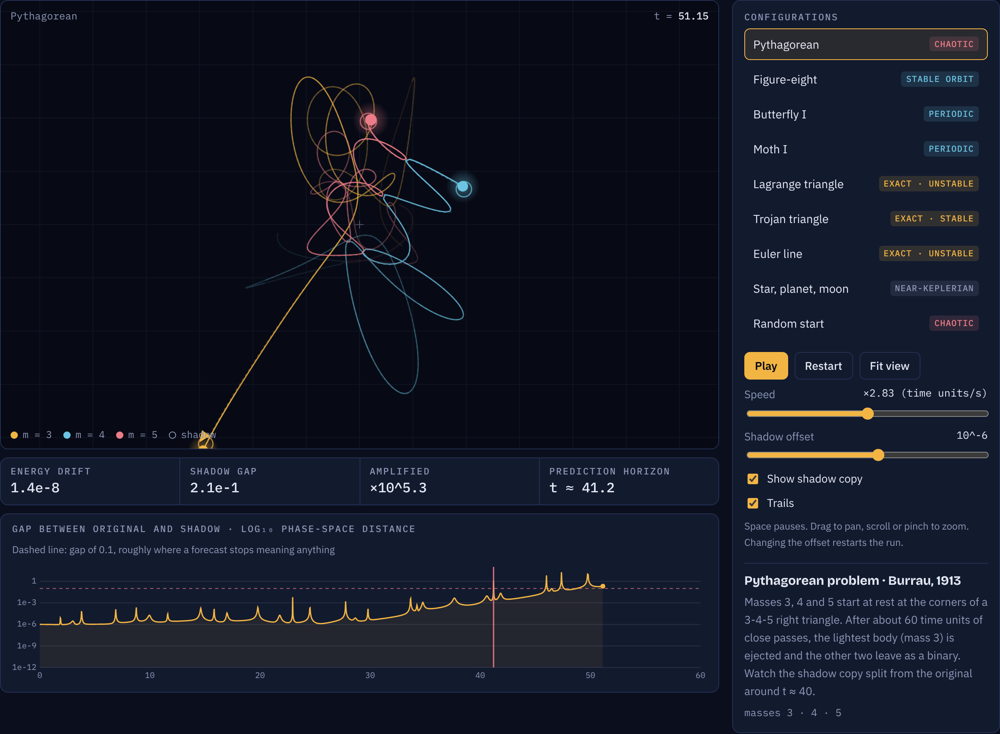

# Three-Body Lab

An interactive gravity simulator that shows what the three-body problem is, why it has no general closed-form solution, and what *has* been solved.

**Live page:** https://earththing.github.io/three-body-simulator/ (GitHub Pages, deployed from `main`)



## The short version

- **No formula exists.** Newton's two-body orbits are conic sections you can write in closed form. With three bodies there aren't enough conserved quantities to do that. Bruns (1887) and Poincaré (1890) proved no further algebraic or analytic integrals exist.
- **A solution does exist.** Sundman (1912) proved the motion is given by a convergent power series. It converges so slowly it has no practical use.
- **The motion is deterministic but chaotic.** A computer can follow any trajectory as precisely as you can afford. In chaotic cases, though, each extra digit of starting precision buys only a roughly fixed amount of extra forecast time.
- **"Solved" has meant three narrower things:** exact special solutions (Euler 1767, Lagrange 1772), periodic orbits found by computer search (figure-eight 1993/2000, thousands more since 2013), and statistical predictions of how chaotic encounters end (Stone & Leigh 2019).
- **Recent "solved" headlines** come from the last two of those. Claims of a general exact solution still turn up as unreviewed preprints. One was posted on Zenodo in March 2026; it hasn't been peer reviewed, and I haven't evaluated it.

All of this is in the page, along with the sources listed in [REFERENCES.md](REFERENCES.md).

## How to use it

### The simulator

Pick a configuration on the right. Every run starts a **shadow copy**, drawn as pale rings with dashed trails, offset by 10⁻ⁿ in one coordinate. How fast the shadow separates from the original tells you whether the motion is stable or chaotic.

| Control | What it does |
|---|---|
| Configurations | Load one of nine starting setups (below). |
| Play / Pause, Space | Pause or resume. |
| Restart | Rerun the current setup from t = 0. Random start keeps its current draw; click *Random start* again for a new one. |
| Fit view | Zoom to fit all three bodies. Bodies outside the view are marked with an arrow at the edge. |
| Speed | Simulated time units per second, ×0.25 to ×32. |
| Shadow offset | Size of the shadow's starting offset, 10⁻¹ to 10⁻¹². Changing it restarts the run. |
| Drag, scroll, pinch | Pan and zoom the view. |

**Readouts under the canvas**

- **Energy drift:** relative change in total energy since t = 0. A check on the integrator, which should stay tiny (about 10⁻⁸ or better).
- **Shadow gap:** distance between the original and the shadow in phase space (positions and velocities together).
- **Amplified:** shadow gap divided by the starting offset.
- **Prediction horizon:** the time when the gap first passed 0.1, about where a forecast stops meaning anything.
- **Chart:** log₁₀ of the gap over time. A straight rising line means exponential divergence (chaos); a flat or slowly rising one means the orbit is stable. Spikes are close passes, where small timing differences briefly look large.

### The configurations

| Name | Kind | What to watch for |
|---|---|---|
| Pythagorean | Chaotic | Burrau's 1913 problem: masses 3, 4, 5 at rest on a 3-4-5 triangle. The shadow splits at t ≈ 41. At t ≈ 60 the lightest body is ejected and the other two leave as a binary, matching Szebehely & Peters (1967). |
| Figure-eight | Periodic, stable | Three equal masses on one curve, period ≈ 6.33. The shadow drifts slowly along the orbit but never separates. |
| Butterfly I | Periodic | From the 2013 computer search. The published starting values have only 5 digits, so the orbit closes to about 10⁻³ and eventually comes apart. |
| Moth I | Periodic | Another 2013 orbit, period ≈ 14.89. |
| Lagrange triangle | Exact, unstable | Equal masses on a rigidly rotating equilateral triangle. It's an exact solution, but any perturbation grows; it breaks up around t ≈ 20. |
| Trojan triangle | Exact, stable | The same triangle with masses 1 : 0.01 : 0.0001. That satisfies Routh's criterion, 27(m₁m₂ + m₂m₃ + m₃m₁) < (m₁ + m₂ + m₃)², so it holds. |
| Euler line | Exact, unstable | Three equal masses on a rotating line. It breaks up within about one rotation. |
| Star, planet, moon | Near-Keplerian | A hierarchical triple: nearly two separate two-body orbits plus small corrections, the regime where classical perturbation theory works. |
| Random start | Chaotic | Equal masses at random positions with negative total energy. Click again for a new draw. |

### Things to try

1. **Pythagorean, offset 10⁻³ vs 10⁻¹²:** nine more digits of precision push the prediction horizon out only a little. This is the main point of the page.
2. **Figure-eight vs Lagrange triangle:** both are exact periodic solutions. Compare their gap charts.
3. **Lagrange triangle vs Trojan triangle:** the same exact solution. Only the mass ratio decides whether it survives.
4. **"Who gets thrown out?" panel:** run 300 encounters with masses 1, 2, 3. The lightest body is ejected about 65–75% of the time. Then try 1, 1, 1 and 1, 1, 5.

### The ensemble panel

You can't predict a single chaotic encounter, but you can predict the odds over many. This panel starts N random bound triples with your chosen masses, integrates each until one body escapes, and tallies which one left. It runs in a Web Worker so the page stays responsive.

A body counts as **escaped** when:
- it is more than 8× the inner pair's separation from that pair's centre of mass,
- it is moving away, and
- its two-body energy relative to the pair is positive.

Runs that haven't resolved by t = 400, or that use up their step budget (120,000 integrator steps), are counted as **still bound**.

This tallies outcomes for the starting conditions described below. It doesn't reproduce the specific ensembles in Stone & Leigh (2019), so treat the agreement as qualitative: the lightest body leaves most often.

## How it works

- **Units:** G = 1, point masses, motion in a plane, centre-of-mass frame.
- **Integrator:** adaptive Dormand–Prince 5(4) (the method behind MATLAB's `ode45` and SciPy's `RK45`), with relative tolerance 10⁻¹¹ (10⁻⁸ in the ensemble).
- **Close passes:** there's no softening. The step size shrinks during close passes instead of the force being smoothed, so energy stays conserved to about 10⁻⁸ through the Pythagorean problem's close encounters.
- **Shadow copy:** a second, independent system offset by 10⁻ⁿ in body 1's x-coordinate and advanced to exactly the same times.
- **Ensemble starting conditions:** positions uniform in the unit disk, random velocities rescaled so kinetic energy = 0.3 × |potential energy| (bound), shifted to the centre-of-mass frame. No angular-momentum constraint.

### Limitations

- Planar motion only, point masses, Newtonian gravity. No collisions, tides or relativity.
- Butterfly I and Moth I use the 5-digit starting values from the 2013 paper. Their small closure errors are real and expected. Li (2013) made the same point about that paper's starting values (see REFERENCES.md).
- The ensemble's starting distribution was chosen for the demo, not taken from a specific paper. Its percentages depend on that choice.
- Physics tests check known results; the UI has no automated tests.

## Running locally

Open `index.html` in any modern browser. It's a single self-contained file; it needs a network connection only for Google Fonts and falls back to system fonts without one.

To change it, edit files in `src/`, then rebuild and test:

```bash
./build.sh
```

```bash
node test/physics.test.js
```

| Path | What |
|---|---|
| `src/physics.js` | Integrator, initial conditions for each configuration, escape detection. Usable from Node or the browser. |
| `src/page.html` | Page, canvas rendering, controls, ensemble worker. |
| `build.sh` | Inlines the physics into the page, producing `index.html` (committed) and `dist/fragment.html` (ignored; a copy without the `<html>` wrapper). |
| `test/physics.test.js` | Checks that the figure-eight, Lagrange and Euler solutions close after one period, that energy is conserved, and that the Pythagorean problem ejects the mass-3 body. |
| `.github/workflows/` | `ci.yml` runs the tests and checks that `index.html` matches `src/`. `pages.yml` deploys `index.html` to GitHub Pages on every push to `main`. |

## Sources

Full citations, including which numbers in the simulator come from which paper and how each citation was checked, are in **[REFERENCES.md](REFERENCES.md)**.
