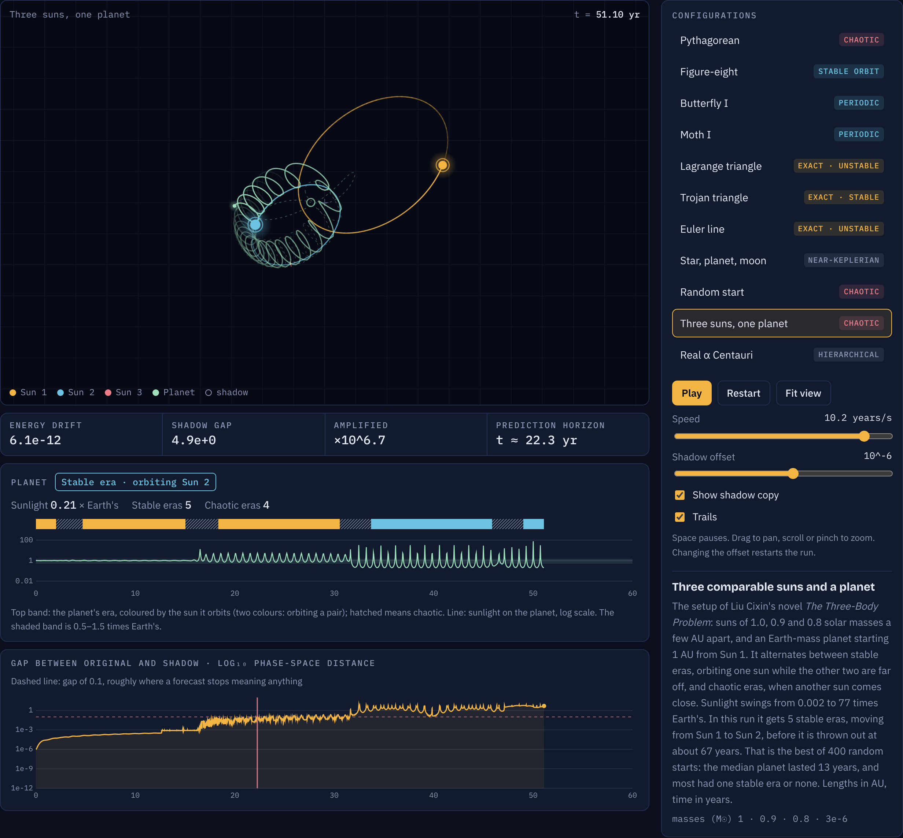
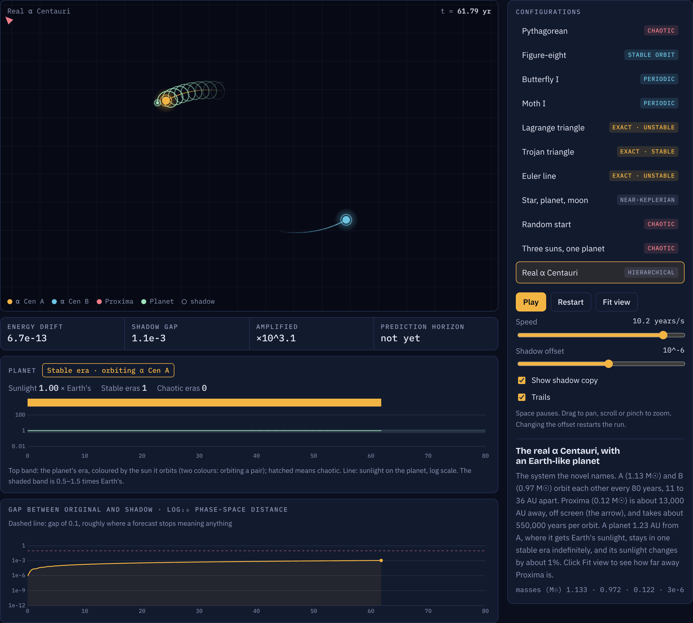

# The novel's three suns: what the physics says

Liu Cixin's *The Three-Body Problem* (2008; English translation by Ken Liu, 2014) sets its alien civilization on a planet with three suns. This note asks two things. Does the book give enough to work out what the orbits looked like? And does what it describes hold up physically?

**Short answer:** the book doesn't give enough to reconstruct the orbits. It does give enough to test them. The pattern of eras it describes is real physics. How long that pattern goes on is not. And the real star system it names behaves completely differently.

Both setups discussed here are in the simulator: **Three suns, one planet** and **Real α Centauri**. The statistics come from `tools/novel-survey.js`, which anyone can rerun (see [Method](#method)).

*Spoilers:* only the premise and setting of the first book.

---

## What the book describes

The book describes the planet almost entirely from its inhabitants' point of view, mostly through an in-story virtual-reality game:

- **Stable eras.** The planet circles one sun in a steady orbit. Days and seasons are regular, and civilization can grow.
- **Chaotic eras.** One or both of the other suns comes close and disrupts the orbit. Sunrises are erratic, with scorching heat or deep cold. The inhabitants survive by "dehydrating" until conditions improve.
- **Flying stars.** Suns so far away they look like stars. Two flying stars mean a stable era is coming. Three mean extreme cold, because all three suns are far away.
- **Cycles.** Civilization after civilization rises in a stable era and is wiped out in a chaotic one. Nobody can predict when an era will end, which is the "three-body problem" of the title.
- **Location.** The system is α Centauri, the nearest star system to the Sun and a real triple.

## What can't be recovered

The book gives no masses, distances, periods or era lengths. A qualitative description like this fits infinitely many orbital configurations, so **the actual orbits can't be reconstructed**. What we can do is ask which kinds of system would produce what the book describes, and whether such a system could last.

## Finding 1: the eras are real physics

The book's stable era, orbiting one sun with two flying stars in the sky, is a precise physical condition. It's the planet being gravitationally bound to one sun while the other two are far enough away that their tidal pull is small. The simulator uses exactly that to decide when an era is stable (see [Method](#method)). "Three flying stars" is the planet on a wide swing away from all three suns, with sunlight collapsing.

Run the simulator's *Three suns, one planet* and that's what happens:



| Years | What happens |
|---|---|
| 0–2 | Stable era around Sun 1 |
| 2–5 | Chaotic era |
| 5–15 | Stable era around Sun 1 |
| 15–18 | Chaotic era |
| 18–31 | Stable era around Sun 1 |
| 31–34 | Chaotic era. The planet changes suns. |
| 34–46 | Stable era around Sun 2 |
| 46–49 | Chaotic era |
| 49–61 | Stable era around Sun 2 |
| 61–67 | Chaotic era, then the planet is **thrown out of the system** |

Sunlight on the planet ranges from **0.002 to 77 times what Earth gets**: deep freeze to sterilizing heat. So the book's pattern, roughly decade-long stable eras broken by a few chaotic years, with temperature extremes, is what a planet among three comparable suns does.

## Finding 2: it doesn't last

That run was picked as the **best of 400**. The typical case is much shorter.

**The experiment:**
- 400 random systems of three suns (1.0, 0.9 and 0.8 solar masses), spread over 6–16 AU, gravitationally bound.
- An Earth-mass planet starts on a circular orbit 1 AU from one of the suns.
- Each run goes up to 150 years.

**What happened to the planet:**

| Outcome | Runs |
|---|---|
| Thrown out of the system | 223 |
| Fell into a sun | 90 |
| Still there after 150 years | 86 |
| Not finished (step budget) | 1 |

| Planet lost within | Share of runs |
|---|---|
| 10 years | 42% |
| 25 years | 61% |
| 50 years | 72% |
| 100 years | 77% |
| 150 years | 78% |

**Median lifetime: 13.5 years.** A quarter of planets were gone within 4.9 years.

**How many stable eras did lost planets get?** Counting eras longer than 1.5 years:

| Stable eras before loss | 0 | 1 | 2 | 3 | 4 | 5 | 6 |
|---|---|---|---|---|---|---|---|
| Planets | 156 | 105 | 39 | 7 | 4 | 1 | 1 |

Half (156 of 313) never had a stable era longer than 1.5 years, and only 13 had three or more. The book needs dozens of cycles at least.

**Why it ends so fast.** Each close pass by a second sun is a gamble: the planet might stay with its sun, switch to the other one, be flung out, or fall in. The planet only gets a few of those gambles before one goes against it. In 276 of the 313 lost cases, **the planet was gone before the three suns had even sorted themselves out**.

**The planets that survived** mostly did so because the chaos stopped. Three-body systems of stars break up on their own: usually one star is flung out and the other two stay together as a pair. Of the 86 survivors:
- In 59, the suns had already broken up that way.
- 51 ended in a permanent stable era around one sun, and 10 around a pair of suns.
- 25 were still in a chaotic era when the 150 years ran out.

A surviving planet ends up in **one stable era forever**, which is the opposite of the novel's cycles.

**On timescale:** Newtonian gravity has no built-in scale. Spread everything 10 times wider and every time goes up about 30-fold (10^1.5), so "13 years" depends on the 6–16 AU spacing I chose. What doesn't change with scale is **how many** stable eras a planet gets. I didn't test the separate question of whether a much wider system with the planet still at 1 AU could do better. I'd expect the gamble at each close pass to stay much the same.

## Finding 3: α Centauri is the wrong kind of triple

The real α Centauri is a **hierarchical** triple, a close pair plus a distant third star. That's the stable kind.

| | Value | Source |
|---|---|---|
| α Cen A | 1.133 M☉, 1.52 L☉ | mass: Pourbaix & Boffin 2016; luminosity: Kervella et al. 2017 (interferometry) |
| α Cen B | 0.972 M☉, 0.50 L☉ | same |
| A–B orbit | period 79.91 yr, eccentricity 0.524, 11–36 AU apart | Pourbaix & Boffin 2016 (semi-major axis 23.8 AU from Kepler's third law) |
| Proxima | 0.12 M☉, about 13,000 AU away (near the far end of its orbit), period ≈ 550,000 yr | Kervella, Thévenin & Lovis 2017 |

Put an Earth-like planet 1.23 AU from A, where it gets the same sunlight as Earth, and run it in the simulator's *Real α Centauri*:



- **One stable era, for the whole run.** The simulator's tests check 200 years. Published long-term studies find planets around A stable out to roughly 2 AU (Quarles & Lissauer 2016).
- **Sunlight changes by about 1%**, from 0.99 to 1.02 times Earth's, including B's contribution.
- **B's pull on the planet is at most 0.2% of A's,** when B is closest. Proxima's is about 10⁻¹³ of A's: nothing.
- **The sky:** one sun (A). Plus B, a brilliant point roughly 150 to 1,500 times brighter than our full Moon depending on where it is in its 80-year orbit. And Proxima, a faint star of about magnitude 4.5 that you'd need a dark sky to see. (My calculations: B from its total light output at 11–36 AU; Proxima from its brightness seen from Earth, magnitude 11.1 at 1.30 parsecs, moved to 13,000 AU.)

In the novel's terms, that's a permanent stable era with **one flying star that never leaves**.

## My read

Liu got the qualitative physics of a chaotic triple right. A planet among three comparable suns really would alternate between calm eras and violent ones, with extremes of heat and cold and no way to predict the next transition. That's a better use of real dynamics than most science fiction manages.

Two things don't hold up:

1. **Duration.** The alternation can't repeat often enough for one civilization after another. A few cycles is the realistic maximum, and the usual outcome is fewer.
2. **The star system.** α Centauri is a textbook example of the stable, hierarchical kind of triple. A planet there would be one of the calmest places in the neighbourhood.

Read charitably, the in-book game is a compressed, dramatized simulation, and the three-body problem is a metaphor for the aliens' unpredictable existence. As astrophysics, the setting would need a different, non-hierarchical triple, and even then it would only work briefly.

## Method

**Physics.**
- Newtonian point masses in a plane.
- Adaptive Dormand–Prince 5(4) integrator, relative tolerance 10⁻¹¹, no softening.
- Units: AU, solar masses, G = 1, so 2π time units is one year.
- Bodies merge, conserving mass and momentum, when they come within their combined radii. Star radius is taken as 0.00465 AU × M^0.8 (a rough main-sequence relation); the planet's radius is Earth's.
- Sunlight is ΣLᵢ/rᵢ², in units of Earth's sunlight. Luminosity is M⁴ (rough main-sequence relation) for the invented suns, and published values for α Centauri.

**Eras.** The planet's status is sampled every 0.25 time units (about 14.5 days):
- **Stable:** bound to one sun, with the other suns' tidal acceleration (2Gm·r/d³ each) totalling less than 1% of that sun's pull.
- **Stable around a pair (circumbinary):** bound to a pair of suns from more than 2.5 times their separation, with the third sun's tidal pull under 1%.
- **Chaotic:** anything else while still in the system.
- **Ejected:** unbound from the suns as a group, more than 3 times farther from their centre than the farthest sun, and moving away.
- **Fell into a sun:** merged.

A new status only becomes a new era once it has lasted 3 time units (about half a year), so brief flickers don't count. The thresholds are judgement calls. Changing them moves era boundaries, but not the main results: how short lifetimes are, and how few eras planets get.

**Random systems.**
- Suns placed uniformly in a disk 6–16 AU across.
- Velocities random, then scaled so kinetic energy is 0.3 times the potential energy's size (bound).
- Moved into the centre-of-mass frame.
- Planet on a circular orbit at 1 AU around a randomly chosen sun, at a random phase.
- Random numbers from a fixed-seed generator (Park–Miller), so the runs are reproducible.

**Reproducibility.**
- The integrator's step sequence doesn't depend on how often its state is read. The page and the survey script therefore compute identical trajectories, and the page gives the same run at any speed setting.
- Different JavaScript engines may round some math functions differently in the last digit. In a chaotic run, that can change the details after a few decades, just as the shadow copy shows.

```bash
node tools/novel-survey.js
```

```bash
node tools/novel-survey.js 1000 42
```

The first reproduces the numbers above and takes a few minutes. The second runs 1,000 systems with a different seed. Add `--json` to save every run's starting state and era list. The *Three suns, one planet* setup is run 1003911449 (its starting seed) from the default survey.

**Not modelled:**
- Three dimensions. Real orbits are tilted relative to each other, which changes the details but not the instability.
- Tides, stellar evolution, the planet's spin and climate.
- Any intervention by the inhabitants.

## Sources

The novel, the α Centauri measurements and the stability studies are listed with full citations under "The novel and α Centauri" in [REFERENCES.md](../REFERENCES.md).
